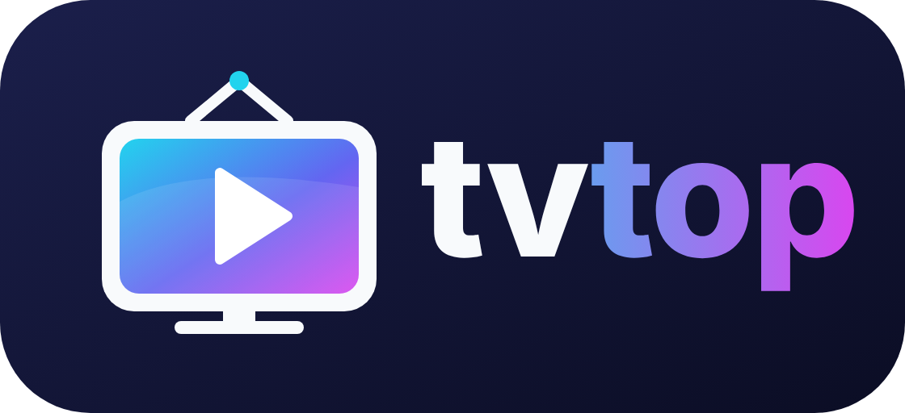

# tvtop

<p align="center"></p>

Aplikacja Compose Multiplatform na Androida i iOS.

## Struktura

- `composeApp/` – wspólny kod UI (`commonMain`) oraz kod platformowy (`androidMain`, `iosMain`)
- `iosApp/` – źródła Swift hosta iOS

## Android

```sh
./gradlew :composeApp:assembleDebug
```

## iOS

Wymaga macOS i Xcode. Projekt Xcode (`iosApp.xcodeproj`) nie jest jeszcze dodany –
utwórz go w Xcode (App, SwiftUI, nazwa `iosApp`, w katalogu `iosApp/`), podepnij istniejące
pliki Swift i dodaj fazę Run Script:

```sh
cd "$SRCROOT/.."
./gradlew :composeApp:embedAndSignAppleFrameworkForXcode
```

## Dystrybucja do testerów (Firebase App Distribution)

Każdy push na `main` buduje podpisany APK release i wysyła go do grupy `testers`
w Firebase App Distribution (workflow `.github/workflows/distribute-android.yml`,
można go też uruchomić ręcznie przyciskiem „Run workflow”).

Jednorazowa konfiguracja:

1. W [Firebase Console](https://console.firebase.google.com/) utwórz projekt i dodaj aplikację
   Android z pakietem `pl.tvtop`. Skopiuj jej **App ID** (`1:…:android:…`).
2. W App Distribution utwórz grupę testerów o aliasie `testers` i dodaj do niej adresy e-mail.
3. W Google Cloud Console (ten sam projekt) utwórz konto usługi z rolą
   **Firebase App Distribution Admin** i pobierz klucz JSON.
4. Wygeneruj keystore do podpisu (przechowuj go bezpiecznie, zmiana klucza wymusza
   odinstalowanie aplikacji u testerów):
   ```sh
   keytool -genkeypair -v -keystore release.keystore -alias tvtop \
     -keyalg RSA -keysize 2048 -validity 10000
   base64 -w0 release.keystore   # na macOS: base64 -i release.keystore
   ```
5. W repo: Settings → Secrets and variables → Actions dodaj sekrety:

   | Sekret | Wartość |
   |---|---|
   | `FIREBASE_ANDROID_APP_ID` | App ID z kroku 1 |
   | `FIREBASE_SERVICE_ACCOUNT_JSON` | cała zawartość pliku JSON z kroku 3 |
   | `ANDROID_KEYSTORE_BASE64` | wynik `base64` z kroku 4 |
   | `ANDROID_KEYSTORE_PASSWORD` | hasło keystore |
   | `ANDROID_KEY_ALIAS` | `tvtop` (alias z kroku 4) |
   | `ANDROID_KEY_PASSWORD` | hasło klucza |

`versionCode` jest ustawiany na numer uruchomienia workflow, więc każdy build ma wyższą wersję.
